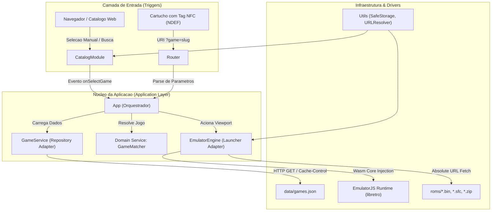
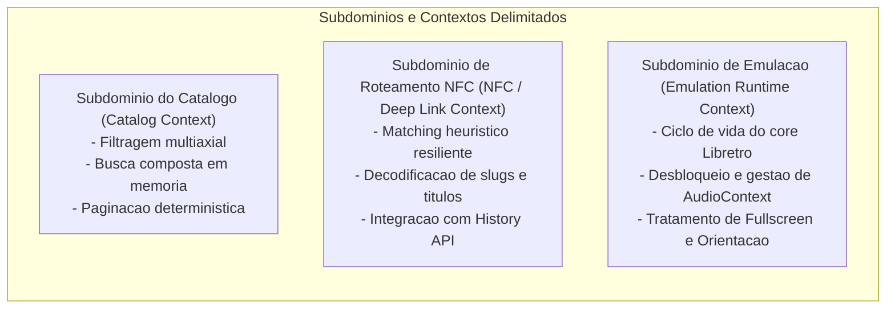
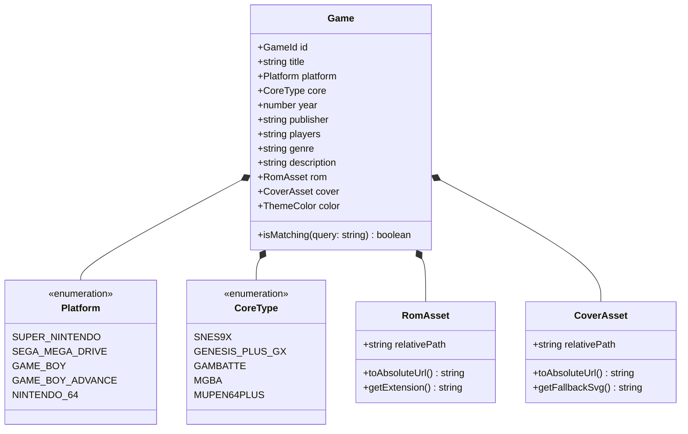
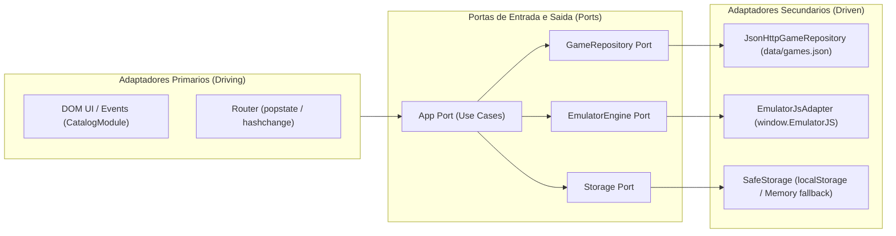

# Arquitetura, DDD e Estrategia TDD - Retro NFC Touch Web Player

## 1. Visao Geral e Contexto do Sistema

O **Retro NFC Touch - Web Player** e uma aplicacao web mobile-first de execucao de emuladores retroativada por aproximacao fisica de cartuchos com chip NFC (NDEF URI) ou navegacao direta por catalogo interativo.

O sistema opera como um monolito modular no lado cliente (SPA estatica sem backend proprietario), hospedado em infraestrutura de borda (GitHub Pages), consumindo Wasm/libretro via CDN (EmulatorJS) e ativos estaticos canonicos (ROMs e Boxart).



---

## 2. Modelagem Estrategica DDD (Bounded Contexts)

A aplicacao se divide em 3 subdominios delimitados:



### Context Map (Mapa de Contextos)
- **Catalog Context -> Emulation Context:** Quando o usuario seleciona um item do catalogo ou passa pela Landing do card NFC, o agregado `Game` e entregue imutavel ao `EmulatorEngine` atraves de um contrato de inicializacao.
- **NFC Context -> Catalog Context:** O slug recebido via query param e traduzido pelo `GameMatcher` para o ID canonico do agregado antes da transicao de tela.

---

## 3. Modelagem Tatica DDD (Entidades, Value Objects e Contratos)

### 3.1. Agregado `Game` (Aggregate Root)



#### Regras Invariantes do Agregado:
1. **Identidade Canonica (`GameId`):** Slug alfanumerico minusculo sem caracteres especiais (ex: `smw`, `sonic2`, `zelda`).
2. **Compatibilidade Core-Plataforma:** Toda plataforma mapeia estritamente para um core libretro testado:
   - Super Nintendo -> `snes9x`
   - Sega Mega Drive -> `segaMD` (`genesis_plus_gx`)
   - Game Boy / Color -> `gb` (`gambatte`)
   - Game Boy Advance -> `gba` (`mgba`)
   - Nintendo 64 -> `n64` (`mupen64plus`)
3. **Imutabilidade de Ativos:** URLs de ROM e Capas nao aceitam caminhos orfaos e devem passar pela normalizacao canonica (`resolveAssetUrl`).

---

## 4. Servicos de Dominio (Domain Services)

### 4.1. `GameMatcher` (Resolucao Heuristica de NFC)
Permite que uma tag NFC gravada com `smw`, `supermarioworld` ou `Super Mario World` resolva sempre para o mesmo jogo:

```javascript
export class GameMatcher {
  static normalize(str) {
    return String(str || "")
      .toLowerCase()
      .normalize("NFD")
      .replace(/[\u0300-\u036f]/g, "")
      .replace(/[^a-z0-9]/g, "")
      .trim();
  }

  static find(games, query) {
    if (!query || !games || games.length === 0) return null;
    const clean = String(query).toLowerCase().trim();
    const alpha = this.normalize(query);

    // Prioridade 1: ID exato
    let match = games.find(g => g.id.toLowerCase() === clean);
    if (match) return match;

    // Prioridade 2: ID alfanumerico
    match = games.find(g => this.normalize(g.id) === alpha);
    if (match) return match;

    // Prioridade 3: Titulo alfanumerico
    match = games.find(g => this.normalize(g.title) === alpha);
    if (match) return match;

    // Prioridade 4: Nome base de arquivo de ROM ou Capa
    match = games.find(g => {
      const romBase = g.rom.split("/").pop().split(".")[0].toLowerCase();
      return romBase === clean || this.normalize(romBase) === alpha;
    });
    if (match) return match;

    // Prioridade 5: Prefixo no titulo
    return games.find(g => this.normalize(g.title).startsWith(alpha)) || null;
  }
}
```

---

## 5. Arquitetura Hexagonal (Ports and Adapters)

Para assegurar testabilidade total sem acoplamento ao DOM ou APIs globais do navegador:



---

## 6. Estrategia de Test-Driven Development (TDD)

A suite de testes e estruturada em 3 niveis, utilizando o test runner nativo do Node.js (`node:test` e `node:assert`), eliminando dependencias pesadas e executando em milissegundos.

### Matriz de Testes Recomendada

| Modulo / Camada | Tipo de Teste | Objetivo TDD |
| :--- | :--- | :--- |
| `GameMatcher` | Unitario | Garantir resolucao de NFC para slugs, titulos e variantes de espacamento sem falhas. |
| `CatalogFilter` | Unitario | Validar busca multi-termo, case-insensitivity, remocao de acentos e calculo de paginas. |
| `SafeStorage` | Unitario | Garantir isolamento de erros quando `localStorage` lanca `SecurityError` no iOS. |
| `resolveAssetUrl` | Unitario | Garantir resolucao de caminho correto independente de presenca de trailing slash. |
| `games.json` Contract | Integracao | Validar que cada um dos 206 jogos possui ROM e Capa fisicamente existentes no disco. |
| Binary Magic Bytes | Integracao | Validar que capas possuem cabecalhos PNG ou JPEG legitimos e ROMs sao validas. |

### Exemplo de Teste de Dominio Puro (Pronto para Execucao TDD)

```javascript
import test from "node:test";
import assert from "node:assert/strict";
import { GameMatcher } from "../js/core/matcher.js";

test("GameMatcher: deve resolver ID canonico exato", () => {
  const mockGames = [{ id: "smw", title: "Super Mario World", rom: "roms/smw.zip" }];
  const result = GameMatcher.find(mockGames, "smw");
  assert.equal(result.id, "smw");
});

test("GameMatcher: deve resolver slug por titulo sem espacos (NFC tag payload)", () => {
  const mockGames = [{ id: "smw", title: "Super Mario World", rom: "roms/smw.zip" }];
  const result = GameMatcher.find(mockGames, "supermarioworld");
  assert.equal(result.id, "smw");
});

test("GameMatcher: deve retornar null para jogo inexistente", () => {
  const mockGames = [{ id: "smw", title: "Super Mario World", rom: "roms/smw.zip" }];
  const result = GameMatcher.find(mockGames, "residentevil");
  assert.equal(result, null);
});
```

---

## 7. Decisoes Tecnicas e Trade-Offs (ADR Summary)

1. **Vanilla EmulatorJS vs Custom Menu HUD:**
   - *Decisao:* Reverter para a integracao limpa de fabrica da versao 1.
   - *Motivo:* Modais customizados interceptavam eventos de mouse/touch do canvas Wasm e aplicavam filtros de blur que degradavam a taxa de quadros (60fps -> 15fps) e criavam loops de reabertura de modal no mobile.
2. **Formatos de Imagem Rigidos no GitHub Pages:**
   - *Decisao:* Padronizar magic bytes e extensoes (PNG -> `.png`, JPEG -> `.jpg`).
   - *Motivo:* WebKit no iOS nao tolera discrepancia de MIME Type (`Content-Type: image/jpeg` para binarios PNG lanca erro de decodificacao).
3. **Paginacao Mobile-First:**
   - *Decisao:* Paginacao deterministica com 24 itens por pagina e rolagem suave dos chips de categoria.
   - *Motivo:* Evitar sobrecarga de memoria no DOM ao renderizar simultaneamente 206 capas de alta resolucao no mobile.
